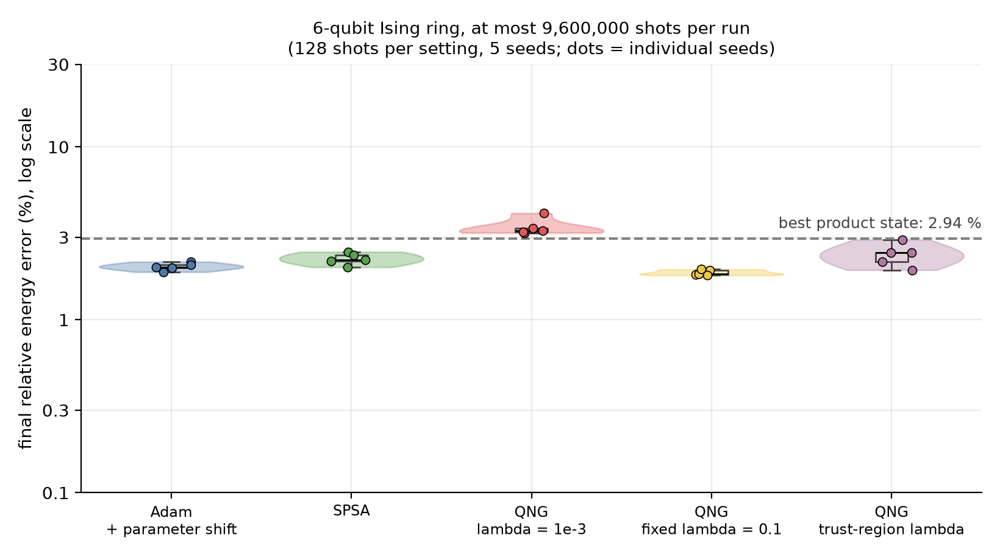
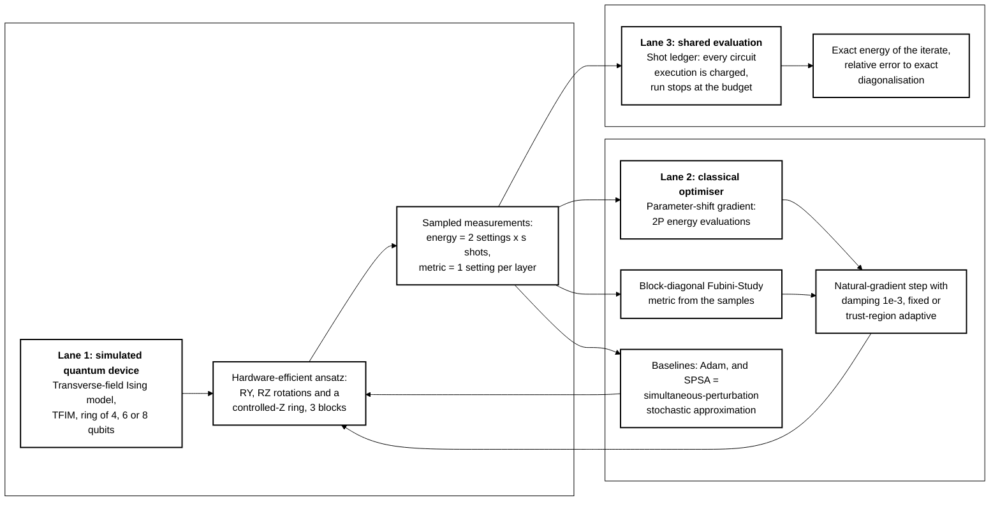
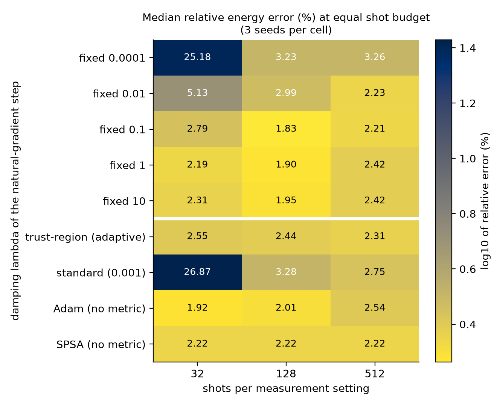
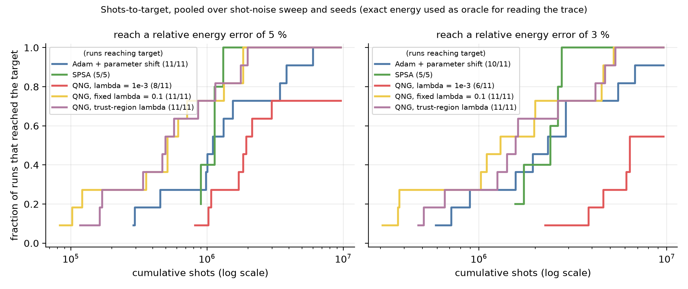
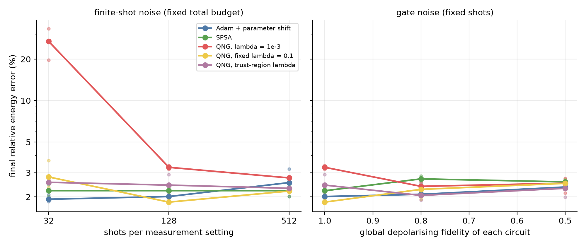
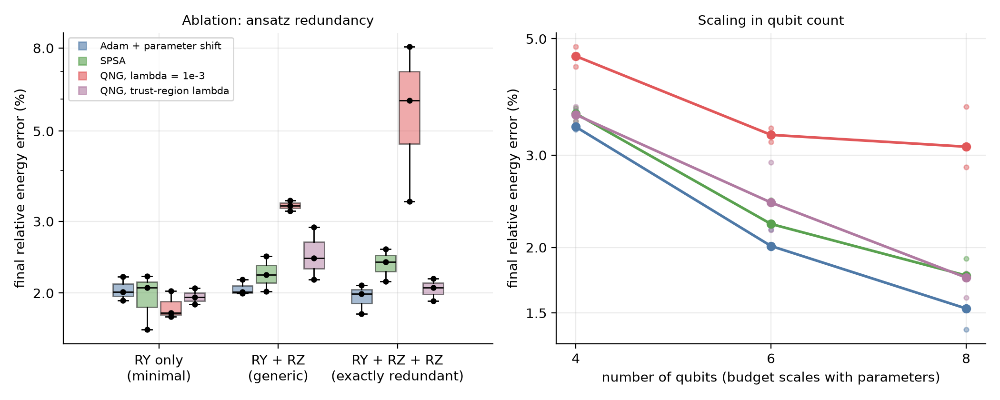

# Shot-budget-fair benchmark of damped quantum natural gradient for variational eigensolvers


[](https://github.com/pradeepdegalaroyal/shot-fair-damped-qng-vqe-benchmark/actions/workflows/ci.yml)

**Abstract.** Damped quantum natural gradient (QNG) is reported to be stable under finite-shot noise and redundant parameters, but stability is usually judged per iteration, while on a device the cost is circuit executions. This simulation study charges every shot (gradient, metric blocks, trust-region evaluations) in a variational quantum eigensolver (VQE) for the transverse-field Ising model (TFIM) on 4-8 qubits and compares standard, fixed-damping and trust-region QNG with parameter-shift Adam and simultaneous-perturbation stochastic approximation (SPSA). Damping is necessary (standard QNG reaches 26.87 % median error at 32 shots per setting and 5.79 % on an exactly redundant ansatz), but at equal total shots damped QNG does **not** beat Adam in final energy error; it only reaches a coarse error target about twice as fast. All results are classical simulations; no quantum advantage is claimed.

## Results at a glance: equal shot budget

6-qubit TFIM ring, generic ansatz (48 parameters), 128 shots per measurement setting, budget 9.6 million shots per run, 5 seeds. The best product state (classical mean-field baseline) has 2.94 % relative error; the ansatz itself cannot go below 1.42 % (`results/reference.json`). Source: `results/summary_main.csv`.

| Method | Final relative energy error (%), mean ± standard deviation | Median shots to first reach 5 % error | Runs reaching 3 % error |
|---|---|---|---|
| Adam + parameter shift (standard quantum baseline) | 2.03 ± 0.10 | 1,105,920 | 5/5 |
| SPSA (shot-frugal baseline) | 2.25 ± 0.17 | 1,140,000 | 5/5 |
| QNG, damping 1e-3 (standard) | 3.44 ± 0.39 | 1,715,200 | 3/5 |
| QNG, fixed damping 0.1 | 1.87 ± 0.07 | 512,000 | 5/5 |
| QNG, trust-region damping | 2.38 ± 0.36 | 496,128 | 5/5 |



*Fig. 1. Damped QNG with a fixed term ends at the lowest error and the standard (nearly undamped) QNG ends above the product-state level; the spread between the three best methods is small compared with the gap to the ansatz floor.*

## What is new here

* A **shot ledger**: every circuit execution an optimiser needs is charged, including the metric circuits and the two extra energy evaluations of the trust-region rule, so QNG variants are compared with Adam and SPSA at the same total number of shots.
* The metric is **estimated from the same finite samples** (block-diagonal Fubini-Study metric from sampled bit strings), so its noise is real, not an exact-metric idealisation.
* A **scale-normalised damping** that makes the damping sweep independent of the step size (a plain `lambda` sweep would silently be a learning-rate sweep).
* One study that crosses shot noise, depolarising noise, an exactly redundant ansatz and qubit count, with pre-stated falsifiable hypotheses, three to five seeds and negative results reported.

## Method at a glance



*Legend: P = number of circuit parameters; s = shots per measurement setting; RY and RZ = single-qubit rotations about the Y and Z axes.*

The optimiser updates the parameters of the ansatz; each iteration's measurements go through the ledger, and the exact energy of the iterate is read out only for evaluation (no optimiser uses it). Details are in `docs/METHOD.md`.

## Motivation and research gap

McClean et al., 2016 (digital object identifier, DOI: 10.1088/1367-2630/18/2/023023) established the variational hybrid loop and McClean et al., 2018 (DOI: 10.1038/s41467-018-07090-4) showed why random starting points fail on larger circuits, which is why this study starts near the identity. Yuan et al., 2019 (DOI: 10.22331/q-2019-10-07-191) review the variational principles behind metric-based updates. Alwan et al., 2027 (DOI: 10.1007/978-3-032-30497-1_18) propose a damped, trust-region QNG that is stable under singular metrics and finite shots and reaches target energies in 1-2 iterations in 2-12 qubit VQE. Temme et al., 2017 (DOI: 10.1103/PhysRevLett.119.180509) and Kjaergaard et al., 2020 (DOI: 10.1146/annurev-conmatphys-031119-050605) frame the noisy intermediate-scale quantum (NISQ) setting where shots and depth are the binding resources.

**Gap.** Robustness is judged per iteration, not per shot. A natural-gradient step needs metric circuits and a trust-region rule needs extra energy evaluations, while SPSA needs two evaluations per step whatever the parameter count. Whether damped QNG wins at equal total shots, and under which shot noise, gate noise and parameter redundancy, is not measured in the cited papers (full related-work table of 12 papers in `docs/RESEARCH_GAP.md`).

**Hypotheses (pre-stated, `docs/RESEARCH_GAP.md`).** H1: median error of standard QNG is at least 2x that of trust-region QNG. H2: median error of the better of Adam and SPSA is at least 1.25x that of trust-region QNG. Each needs a bootstrap 95 % interval of the ratio above 1.

## Results

### Hypothesis tests (`results/hypothesis_tests.json`)

| Test | Median-error ratio | Bootstrap 95 % interval | Mann-Whitney p | Threshold | Verdict |
|---|---|---|---|---|---|
| H1, main setting (5 seeds) | 1.35 | 1.13 to 1.74 | 0.008 | 2.0 | not supported: right direction, too small |
| H1, pooled over sweeps (15 runs each) | 1.13 | 0.99 to 1.47 | 0.013 | 2.0 | not supported |
| H1, exactly redundant ansatz (3 seeds) | 2.89 | 1.55 to 4.21 | 0.100 | 2.0 | supported by the pre-set rule (smallest possible p for 3 vs 3 runs is 0.1) |
| H2, main setting (best baseline: Adam) | 0.83 | 0.69 to 1.04 | 0.151 | 1.25 | **falsified**: trust-region QNG is not better than Adam |
| H2, pooled over sweeps (best baseline: Adam) | 0.86 | 0.81 to 1.04 | 0.213 | 1.25 | **falsified** |

### Damping versus shot noise



*Fig. 2. Standard and weakly damped QNG fail at 32 shots per setting (26.87 % and 25.18 % median error); damping of 0.1 or more is safe everywhere, and no damped variant clearly beats Adam. SPSA is constant across columns by construction (it sets its own shots per evaluation from the budget).*

### Shots needed to reach an error target



*Fig. 3. Damped QNG variants reach the 5 % target at roughly half the shots of Adam and SPSA, and standard QNG often never reaches 3 % (empirical cumulative distribution function, pooled over the shot sweep; the exact energy is used as an oracle to read the trace).*

### Noise robustness



*Fig. 4. Only standard QNG reacts strongly to shot noise; a global depolarising channel with fidelity down to 0.5 does not separate the methods (medians 2.31 % to 2.57 %, `results/summary_noise_sweeps.csv`).*

### Ablation (ansatz redundancy) and scaling



*Fig. 5. Standard QNG degrades as redundant parameters are added (5.79 ± 2.35 % on the exactly redundant ansatz) while the other methods stay near 2 %; errors fall with qubit count for every method.*

Final relative energy error (%), mean ± standard deviation over 3 seeds, 128 shots per setting (`results/summary_ablation.csv`, `results/summary_scaling.csv`):

| Ansatz (6 qubits) | Adam | SPSA | QNG 1e-3 | QNG trust-region |
|---|---|---|---|---|
| RY only | 2.04 ± 0.14 | 1.96 ± 0.30 | 1.85 ± 0.15 | 1.96 ± 0.09 |
| RY + RZ | 2.06 ± 0.09 | 2.23 ± 0.22 | 3.28 ± 0.10 | 2.50 ± 0.38 |
| RY + RZ + RZ (redundant) | 1.95 ± 0.16 | 2.36 ± 0.22 | 5.79 ± 2.35 | 2.05 ± 0.13 |

| Qubits | Adam | SPSA | QNG 1e-3 | QNG trust-region |
|---|---|---|---|---|
| 4 | 3.47 ± 0.16 | 3.59 ± 0.10 | 4.63 ± 0.20 | 3.59 ± 0.12 |
| 6 | 2.06 ± 0.09 | 2.23 ± 0.22 | 3.28 ± 0.10 | 2.50 ± 0.38 |
| 8 | 1.56 ± 0.19 | 1.81 ± 0.08 | 3.22 ± 0.44 | 1.71 ± 0.10 |

## Discussion (including the negative results)

* **Damping is necessary.** The nearly undamped QNG (1e-3) is the only method that breaks under low shot counts (26.87 % median error at 32 shots per setting, against at most 2.79 % for every other method), degrades with redundant parameters and stays 1 to 1.7 percentage points above the others at 6 and 8 qubits. This agrees qualitatively with the claim of Alwan et al., 2027, in a shot-accounted setting.
* **No final-error advantage over Adam at equal shots.** H2 is falsified: trust-region QNG ends at 2.38 ± 0.36 % against 2.03 ± 0.10 % for Adam. Fixed damping 0.1 ends lowest (1.87 ± 0.07 %), but that was an exploratory observation on a grid row, not a pre-stated test, and the difference to Adam is about one seed standard deviation.
* **Early progress is faster.** Damped QNG variants first reach 5 % error after about half the shots of Adam or SPSA (512,000 and 496,128 against 1,105,920 and 1,140,000 median shots, 5/5 seeds). For the 3 % target the main-setting medians are 1,305,600 (fixed 0.1) and 1,566,720 (trust-region) against 2,334,720 (Adam) and 2,400,000 (SPSA) shots (`results/runs.csv`); after that all methods hit a plateau.
* **The plateau is mostly the ansatz and the shot noise.** The generic 6-qubit ansatz cannot go below 1.42 % (`results/reference.json`), and the final iterates sit at 1.9 % to 2.4 %, so differences between the best methods are compressed. The product-state level (2.94 %) is the only classical reference; every method except standard QNG beats it on average.
* **The trust-region rule is noise-driven here.** Its damping ended at a mean of 3.57 (start 0.1), i.e. the noisy gain ratio mostly pushed it towards large damping, where the step becomes scaled gradient descent. It also paid for two extra evaluations per step. It was not better than the fixed 0.1.
* **Gate noise is not discriminating.** With a global depolarising channel, all expectation values are rescaled, so it mostly lowers the signal to noise ratio equally for every method.

## Limitations

* Simulation only: exact statevectors with sampled outcomes, up to 8 qubits, one model (critical TFIM ring), one ansatz depth, a global depolarising channel as the only gate-noise model (shared by gradient and metric circuits, which is optimistic for the shorter metric circuits).
* The metric is block-diagonal per layer; a full quantum geometric tensor needs more circuits and is not covered.
* Three to five seeds: the tests have low power (3 vs 3 runs cannot give a Mann-Whitney p below 0.1). Step sizes were tuned from three values on two separate seeds at one setting only.
* SPSA is a design choice: shots per evaluation were raised so that the budget is used in at most 800 iterations (about 3,000 shots per setting). Another allocation could change its ranking.
* The hypothesis thresholds were written after a small exploratory run on the tuning seeds (disclosed in `docs/METHOD.md`).
* Final iterates are scored with the exact energy, which a device does not provide; the shots-to-target curves are oracle readings of the trace.
* The full run took longer than planned (see below), and iteration caps (1,500, SPSA 800) can leave part of the budget unused; actual shots used are in `results/runs.csv`.

## Future work

* Hardware-style transpilation: charge circuit depth and two-qubit gate count for the metric circuits, and combine with zero-noise extrapolation (Temme et al., 2017) to test whether mitigation shots erase the early-progress benefit.
* Full metric through overlap or Hadamard-test circuits, and other Hamiltonians (Heisenberg and fermionic models) where the mean-field gap is larger.
* A noise-aware damping rule (gain ratio averaged over iterations) and a learned damping schedule.
* A simulator batched on graphics processing units (as in Nguyen et al., 2027, DOI: 10.1007/978-981-92-2587-3_22) to reach 12-20 qubits.

## Reproducibility

```bash
pip install -r requirements.txt
python -m pytest -q                              # 12 fast tests
python experiments/run_all.py --quick            # smoke run on 4 qubits, about 40 s
python experiments/run_all.py                    # full study, writes results/ and figures/
python experiments/make_figures.py               # rebuild figures and tables from results/runs.csv
```

The full run executed 169 evaluation runs plus a tuning stage in 1,113 s (about 18.5 minutes, above the 15-minute target) with six worker processes on a Windows 11 laptop (16 central processing unit threads, Python 3.11.9, NumPy 2.2.6). Only the central processing unit is used; the graphics card is not needed. Every run is deterministic given its seed. Quick-mode outputs go to `results_quick/` and `figures_quick/`.

## Project structure

```
src/shotfair_qng/   circuit.py (batched statevector), hamiltonian.py (TFIM, sampled energy and metric),
                    vqe.py (optimisers and shot ledger), plotting.py (tables, tests, figures)
experiments/        run_all.py (whole study), make_figures.py (figures from saved results)
tests/              test_core.py (12 tests: exact energy, parameter shift, estimator bias, metric, ledger)
docs/               RESEARCH_GAP.md, METHOD.md
results/            runs.csv, summary_*.csv, hypothesis_tests.json, reference.json, tuned_lr.json, traces.json
figures/            fig1 to fig5 (200 dpi)
```

## Related work by the author

* [Hardware-Efficient-QPU-Ansatz](https://github.com/pradeepdegalaroyal/Hardware-Efficient-QPU-Ansatz): hardware-efficient ansatz design, the circuit family used here.
* [QEM-ZeroNoise-Extrapolation](https://github.com/pradeepdegalaroyal/QEM-ZeroNoise-Extrapolation): zero-noise extrapolation, the natural next step for the noise study.

## Citation

```bibtex
@software{degala_shotfair_qng_2026,
  author  = {Degala, Chenchupradeep},
  title   = {Shot-budget-fair benchmark of damped quantum natural gradient for variational quantum eigensolvers},
  year    = {2026},
  version = {0.1.0},
  url     = {https://github.com/pradeepdegalaroyal/shot-fair-damped-qng-vqe-benchmark},
  license = {MIT}
}
```

MIT license (`LICENSE`). Citation metadata is also in `CITATION.cff`.
